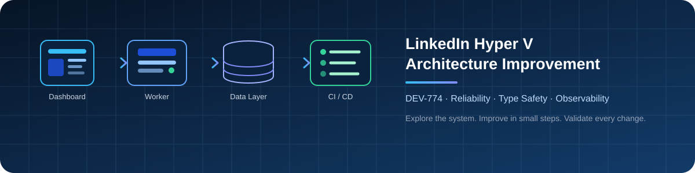

# LinkedIn Hyper V Architecture Improvement

**DEV-774 · Architecture Research, Reliability & DevOps**

*Understand the system first. Make focused improvements. Prove them with tests and operational checks.*

---

## Overview

This repository tracks architecture research and the improvement plan for **DEV-774 — Improvement of LinkedIn Hyper V**. The project is understood to include a **Next.js dashboard** and a **Node.js background worker** supporting LinkedIn-related workflows.

The goal is to improve maintainability, consistency, deployment reliability, observability, and safe operation without adding unnecessary complexity. Work starts by verifying the current implementation, documenting what is actually present, and then prioritizing small, testable changes.

> **Working principle:** Treat the existing codebase as the source of truth. The tools and design ideas below are areas to verify, not claims that every component is already implemented.

## Goals

- Improve maintainability through consistent TypeScript usage.
- Define shared, versionable contracts for data passed between services.
- Standardize local development, automated checks, and container builds.
- Make service health, errors, background jobs, and deployment status easier to inspect.
- Improve resilience through bounded retries, idempotency, and duplicate-event handling.
- Keep configuration, credentials, and operational policies explicit and reviewable.
- Document architecture decisions, test results, and follow-up work as implementation progresses.

## Technology Stack

| Technology / Tool | Intended role | What to verify |
|---|---|---|
| Next.js | Dashboard and web application | App structure, routes, API boundaries, build commands |
| Node.js | Server-side and worker runtime | Entry points, process lifecycle, error handling |
| TypeScript | Static typing across application modules | Migration coverage, compiler settings, strictness |
| Shared types / schemas | Consistent data contracts | DTOs, validation rules, API and event payloads |
| Prisma | Database access, if used | Schema, migrations, generated client, transactions |
| Docker | Repeatable application and worker environments | Dockerfiles, image size, runtime user, health checks |
| GitHub Actions | Automated CI | Lint, type-check, tests, build, security checks |
| Nomad | Workload scheduling, if used | Job specifications, service discovery, secrets, rollouts |
| Pino or equivalent | Structured logging | Logger setup, request/job context, log levels, redaction |
| Metrics and health endpoints | Operational visibility | Readiness/liveness, service metrics, job outcomes |
| Test tooling | Regression protection | Unit, integration, API, worker, and failure-path coverage |

*The epic references these areas; confirm exact dependencies, versions, and existing implementations from repository files before changing configuration.*

## Architecture Overview

This is a **working conceptual model**. Update it after tracing actual entry points, API calls, queue or event flow, and database access.

~~~mermaid
flowchart LR
    U[User / Operator] --> UI[Next.js Dashboard]
    UI --> API[API / Service Layer]
    API --> W[Node.js Worker]
    W --> DATA[(Database / Prisma)]
    W --> EVT[Jobs / Events / Webhooks]
    EVT --> CON[Consumers / Integrations]

    TYPES[Shared TypeScript Types] -. contracts .-> UI
    TYPES -. contracts .-> API
    TYPES -. contracts .-> W

    REPO[Git Repository] --> CI[GitHub Actions]
    CI --> CHECKS[Lint · Types · Tests · Build]
    CHECKS --> IMG[Container Image]
    IMG --> DEPLOY[Deployment / Runtime]

    W --> LOG[Structured Logs]
    API --> LOG
    LOG --> OBS[Monitoring / Alerts]
~~~

### Main components

- **Dashboard:** User-facing interface and entry point for supported workflows. Verify routes, API calls, and error states.
- **API/service layer:** Validate requests, enforce authorization and input rules, and coordinate work. Keep business logic out of transport handlers where practical.
- **Background worker:** Run asynchronous tasks with explicit job state, timeout behavior, retry rules, and terminal-failure handling.
- **Data layer:** Own persistence and schema changes. Validate migrations and avoid silently breaking existing data.
- **Shared contracts:** Keep API payloads, worker inputs, and event shapes aligned. Validate untrusted input at runtime; compile-time types cannot validate incoming JSON.
- **CI/CD:** Run consistent quality gates before packaging and deployment.
- **Observability:** Correlate requests and jobs using structured logs, health checks, useful metrics, and actionable alerts.

## Implementation Roadmap

### Phase 1 — Discover and establish a baseline

1. Review repository structure, package manifests, lockfiles, environment examples, Dockerfiles, and deployment definitions.
2. Identify app and worker entry points, service boundaries, database access, external integrations, and background-task flow.
3. Record current commands for installation, development, linting, tests, type-checking, builds, and deployment.
4. Run existing checks and document failures before making changes.
5. Create an architecture map and list risks, unknowns, and quick wins.

**Deliverable:** Verified architecture notes and a reproducible baseline.

### Phase 2 — Improve TypeScript consistency

1. Check TypeScript coverage and compiler configuration before planning a migration.
2. Prioritize high-value worker modules and shared interfaces instead of rewriting everything at once.
3. Define shared types for API requests/responses, job payloads, events, and error shapes.
4. Add runtime validation at external boundaries.
5. Enable stricter compiler options incrementally and fix errors in manageable groups.

**Validation:** Type-check passes, contracts are covered by tests, and existing behavior remains compatible.

### Phase 3 — Strengthen CI and container builds

1. Standardize CI jobs for dependency installation, linting, type-checking, tests, and production builds.
2. Build Docker images in CI to catch missing files and build errors early.
3. Use reproducible dependency installation and sensible build caching.
4. Review image layers, .dockerignore, runtime permissions, and unnecessary packages.
5. Pin actions and base images to appropriate versions; add dependency or image vulnerability checks where practical.

**Validation:** A clean checkout passes required checks and produces a runnable image.

### Phase 4 — Make deployments predictable

1. Trace the current deployment path and verify whether Nomad definitions are actively used.
2. Separate development and production configuration; document required environment variables without committing secrets.
3. Add deployment health checks and clear startup/shutdown behavior.
4. Define rollout and rollback procedures appropriate to the actual platform.
5. Confirm migrations and worker restarts are handled in a controlled order.

**Validation:** Deployment steps are documented, health is observable, and rollback expectations are clear.

### Phase 5 — Improve logging, health, and monitoring

1. Use structured logs with consistent fields such as timestamp, severity, service, request/job ID, and error context.
2. Never log credentials, access tokens, cookies, or sensitive user data.
3. Add or verify liveness and readiness checks where supported.
4. Track useful signals such as request failures, job outcomes, retry counts, queue lag where applicable, and process health.
5. Add actionable alerts and document how to investigate them.

**Validation:** A developer can trace a failed request or job and determine whether the service is healthy.

### Phase 6 — Make asynchronous work resilient

1. Map each job/event path and identify how timeouts and dependency failures are handled.
2. Apply bounded retries with backoff only to retryable failures.
3. Make repeated delivery safe through idempotency keys or deduplication where appropriate.
4. Define terminal-failure handling and a dead-letter strategy if the architecture uses a queue or equivalent.
5. Test duplicate events, partial failures, timeouts, restarts, and recovery.

**Validation:** Failure scenarios have predictable outcomes, and retries do not accidentally repeat side effects.

### Phase 7 — Review operational safety and access

1. Centralize and test rate-limit and job-execution policies where relevant.
2. Respect platform rules and user consent; do not design automation to bypass restrictions or promise account-safety guarantees.
3. Apply least-privilege access to credentials, CI jobs, deployment identities, and runtime services.
4. Keep secrets out of source control and redact sensitive values from logs.
5. Document limits, failure behavior, and operator controls.

**Validation:** Policies are explicit, auditable, and tested; credentials are not exposed in code or logs.

## CI Quality Gates

| Gate | Purpose |
|---|---|
| Dependency installation | Reproduce the locked dependency graph |
| Formatting and lint | Catch style issues and common mistakes |
| Type-check | Catch incompatible types and contract drift |
| Unit tests | Verify isolated logic and edge cases |
| Integration tests | Verify API, database, and worker interactions |
| Production build | Confirm deployable artifacts can be produced |
| Container scan | Identify known image vulnerabilities |
| Secret/dependency checks | Catch accidental exposure and risky dependencies |
| Deployment smoke test | Confirm the deployed service starts and responds |

Do not add every gate blindly. Start with existing scripts, choose checks that run reliably, and expand coverage as the baseline improves.

## Working Workflow

1. **Inspect:** Read the existing implementation before proposing structural changes.
2. **Document:** Separate confirmed facts from assumptions and open questions.
3. **Prioritize:** Choose one small change with a clear problem statement and acceptance criteria.
4. **Implement:** Keep changes focused, reviewable, and consistent with project conventions.
5. **Test:** Run relevant tests first, then the full required checks.
6. **Review:** Inspect the diff, configuration changes, logs, and failure paths.
7. **Record:** Document what changed, commands run, results, limitations, and next steps.

### Task record template

For every improvement, capture:

- **Problem:** What is unreliable, unclear, duplicated, or difficult to maintain?
- **Evidence:** Which file, command, test, or runtime behavior confirms it?
- **Change:** What is the smallest useful implementation?
- **Acceptance criteria:** What must be true for the task to be complete?
- **Validation:** Which tests or operational checks were run?
- **Follow-up:** What remains unresolved?

## Initial Checklist

- [ ] Map the repository and identify app/worker entry points.
- [ ] Verify actual dependencies and supported runtime versions.
- [ ] Record existing local and CI commands.
- [ ] Run baseline lint, type-check, tests, and build where available.
- [ ] Trace one complete workflow from dashboard/API through worker and persistence.
- [ ] Confirm deployment method and health-check behavior.
- [ ] Identify the first agreed, testable improvement.
- [ ] Record results and update these notes as facts are verified.

## Current Status

**Current stage:** Architecture exploration and technical research.

**Immediate next steps:** Verify the codebase, document the baseline, confirm which stack components are actually in use, and select the first implementation task with clear acceptance criteria.

The items in this plan are proposed improvements. Mark them complete only after the relevant change and validation have been performed.

## References

- [Project repository](https://github.com/Acumen-org/Linkedin-Hyper-V)
- [TypeScript documentation](https://www.typescriptlang.org/docs/)
- [Docker documentation](https://docs.docker.com/)
- [GitHub Actions documentation](https://docs.github.com/en/actions)
- [Prisma documentation](https://www.prisma.io/docs)
- [Nomad documentation](https://developer.hashicorp.com/nomad/docs)
- [OpenTelemetry documentation](https://opentelemetry.io/docs/)

---

DEV-774 · Understand the system · Improve incrementally · Validate thoroughly

